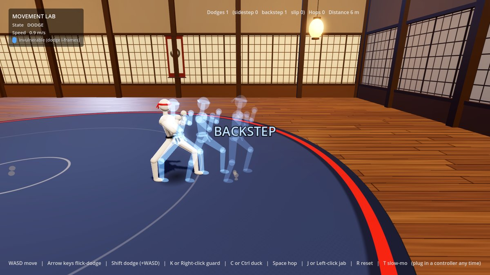

# Stickman Dojo (prototype)

A 3D martial arts prototype built around **defensive movement**: dodging, sidestepping, ducking and hopping.
Right now it's a **movement lab**: just your fighter in an empty dojo, so footwork and dodges can be tuned until
they feel right on a controller. Opponents come back once the movement feels good.

Everything is made from primitive shapes, small procedural shaders and procedural animation, so there are no
external assets. The fighter is a jointed mannequin in a white gi with a black belt and a red headband. Every joint
is driven by a damped spring, with a walk cycle, lean, a fighter's bounce and landing recoil layered on top, and
two-bone IK keeps arms and legs the same length in every pose.



## How to run

1. Install **Godot 4.3 or newer** (standard build, not .NET): https://godotengine.org/download
2. Open Godot, click **Import**, and select `project.godot` in this folder.
3. Press **F5** (or the ▶ Play button at the top right).

Plug in a controller before or after launching. Xbox, PlayStation and most generic pads work.

## Controls

| Action | Controller (Xbox / PlayStation) | Keyboard / mouse |
|---|---|---|
| Move (the fighter turns to face where it walks) | Left stick (or D-pad) | WASD |
| **Flick dodge** (any direction) | Flick the right stick | Tap an arrow key |
| Dodge button (in the left-stick direction, or back if centred) | RB / R1 (or RT / R2) | Shift or L (+ WASD) |
| Guard (hold; keeps your facing so you can strafe) | LB / L1 (or LT / L2) | K or right mouse |
| **Duck** (hold) | B / Circle | C or Ctrl |
| **Hop** (with a little air control) | A / Cross | Space |
| Jab | X / Square | J or left mouse |
| Reset | Start / Options | R |
| Slow motion (50%) | Back / View / Share | T |

Directions are relative to the camera, which always looks the same way, so "up" on the stick is always "into the
screen". The dodge animation depends on where the dodge goes compared to where you're facing: to the side is a
**sidestep**, away is a **backstep**, toward is a short **slip** in.

The top-left panel shows your state, speed, and a lamp that lights while you're invulnerable. Your dodge also leaves
blue afterimages for exactly that long.

## Tuning the feel

All the numbers are constants at the top of `scripts/player.gd`:

| Constant | What it changes |
|---|---|
| `MOVE_SPEED`, `MOVE_ACCEL` | Walking speed, and how snappy vs. slidey starting and stopping feels |
| `TURN_SPEED` | How quickly the fighter turns to face its walking direction |
| `DODGE_TIME`, `DODGE_DISTANCE`, `FORWARD_DODGE_DISTANCE` | Dodge length and travel |
| `DODGE_IFRAMES` | How long a dodge makes you invulnerable |
| `INPUT_BUFFER` | How early a press still counts when you're mid-move |
| `FLICK_TRIGGER`, `FLICK_TIME`, `FLICK_RESET` | How hard and fast a right-stick flick has to be |
| `JUMP_TIME`, `JUMP_HEIGHT` | Hop arc |

The follow camera's distance, follow speed and look-ahead are `CAM_OFFSET`, `CAM_FOLLOW` and `CAM_LEAD` in
`scripts/main.gd`.

## Code layout

| File | What it does |
|---|---|
| `scripts/main.gd` | Sets up the scene, follow camera and HUD |
| `scripts/player.gd` | Player state machine, movement and dodges (tuning constants at the top) |
| `scripts/stickman.gd` | Mannequin body, spring-driven joints, IK, walk cycle, afterimage trails |
| `scripts/poses.gd` | Pose library (joint positions), including attack poses kept for later |
| `scripts/dojo.gd` | The dojo set, lighting and environment (floor, mat, shoji walls, lanterns) |
| `scripts/fx.gd` | Visual-only effects: dust, afterimages, and spark/ring bursts for when combat returns |
| `scripts/input_setup.gd` | Gamepad and keyboard bindings |
| `tests/bot_test.gd` | Headless bot that drives the fighter and checks movement |

## Headless smoke test

```
godot --headless --path . --fixed-fps 60 -s tests/bot_test.gd -- mixed
```

Modes: `walk`, `dodge` (dodge button in rotating directions), `flick` (right-stick flicks), `mixed` (everything),
`idle`. Each runs 30 seconds, prints movement stats, and exits with code 1 if the fighter leaves the arena or a
dodge fails to move it.
